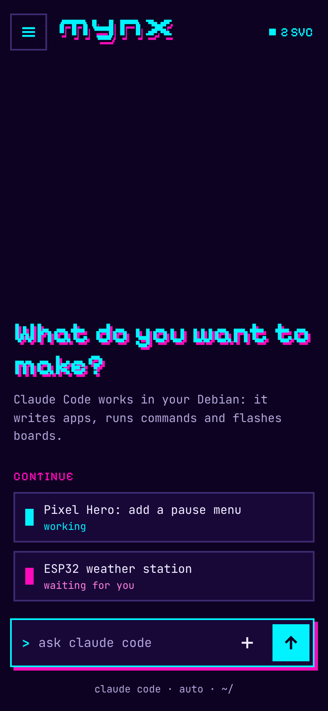
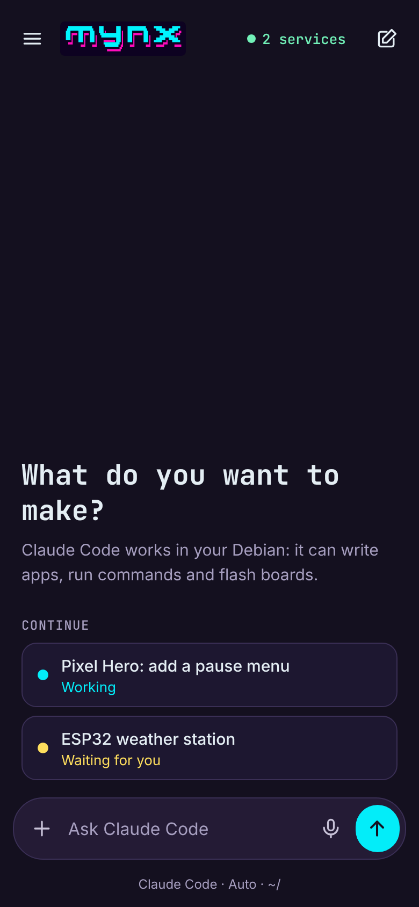
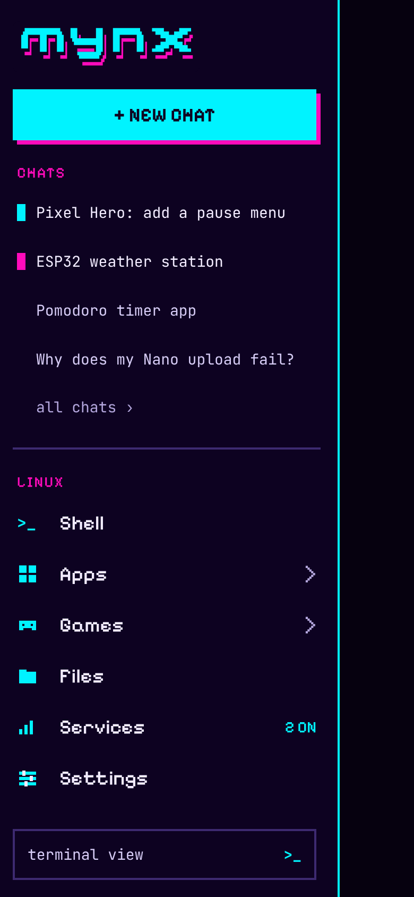
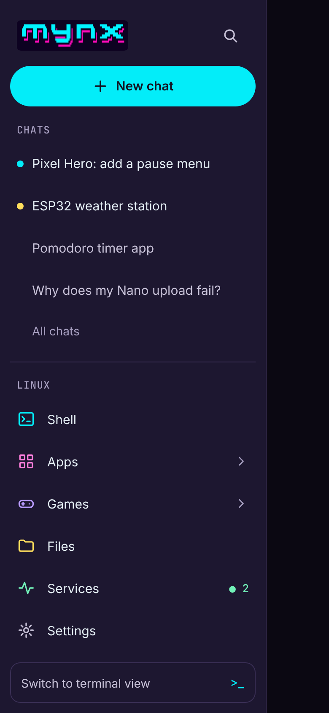
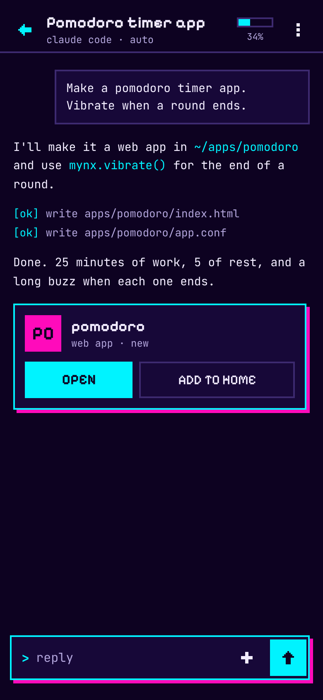

# Touch mode: chat first, with a drawer

The design for touch view's next step (maintainer's decision,
2026-11-11; roadmap "Touch mode", work log "Next" 4). The pictures
are mock-ups from a design study, drawn in a browser at 390 × 844 dp
(2× pixels): sample data, not the app. Where this text and a picture
differ, the text wins.

| Pixel style | First pass |
|---|---|
|  |  |
|  |  |
|  | The chat screen as built today (CI's `screenshots`) |

## Screens

**Chat home** (touch view's start screen, replacing Home's list):
- Top row: ☰ (opens the drawer), the title art, and the services
  count (`● N`, as the strip's `servicesMark()`), which opens the
  Services list. Nothing when no service runs.
- A heading ("What do you want to make?") and one line on what the
  agent can do, pushed to the bottom half so the thumb reaches it.
- **Continue:** live chats only, `ChatHub`'s rows with a
  `ChatRowState` of `WORKING` (cyan mark, "working") or `WAITING`
  (pink mark, "waiting for you"); idle and past chats stay in the
  history. At most three; none, no heading.
- The prompt box as the chat screen's (+ for context, the mic,
  Send); the mock-ups leave the mic out, keep it. Sending starts a
  new chat (`ChatHub.newChat()`) and shows it.
- A line under it: agent, mode and folder ("claude code · auto · ~/").
- Claude Code not installed: the box is replaced by an Install
  button (`menu --act agent:claude`), as Home's "(install)" item.

**Drawer** (over the chat home, about 82% of the width, a dimmed
scrim over the rest; tap ☰ to open, tap the scrim or Back to close;
no edge swipe, which is Android's Back):
- The title art, then **New chat** (the main action).
- **Chats:** the latest few from `chatHistory()` (live ones first,
  marked as on the chat home), then **All chats**, which opens the
  history screen (`ChatHistoryView`, unchanged).
- **Linux:** Home's main list, `HomeMenus.items(HOME_MAIN)`, in
  `menu.conf`'s order and with its actions: Shell, AI agents,
  Services (with the count), Apps, Terminal apps, Games, Files,
  Settings by default. The mock-ups show a subset; show them all.
  Items that open a list (`HomeAction.Menu`: Apps, Games, …) get a
  › and open Home's list screen at that list (`HomeView.showMenu()`),
  whose Back returns to the chat home; the others act as on Home.
- At the bottom: **Terminal**, which shows the tabs, as Home's
  Terminal button does today (the `view` setting stays `touch`).

**A chat:** the screen as built (← back, title, mode, the usage ring,
⋮; the + sheet; artifact cards). ← goes to the chat home, not to
Home's list. Only the style changes, if the pixel style is chosen.

**Back** (`MainActivity.goBack()`): a chat → the chat home; the
drawer → closed; history → the chat home; a Home list or the
terminal → the chat home; the chat home → leaves the app, as Home's
main list does today.

## Where the logic goes

- `core`: what the chat home and the drawer list. A small model
  (e.g. `ChatHomeModel`) built from `HomeMenus` and `chatHistory()`:
  the Continue rows, the drawer's chats (how many, which first), the
  Linux items. Test-first; reuse `tests/fixtures/menu.conf`.
- `app`: `ChatHomeView` and `DrawerView`, thin, drawing that model;
  `MainActivity` shows the chat home where it showed `HomeView` in
  touch view. The service keeps which screen shows (`chatPlace`), so
  a recreated activity comes back to it.
- Screenshots: add the chat home and the drawer to
  `app/src/test/.../Screenshots.kt` at the usual sizes (412 and 360
  dp wide, landscape).

## Style (not decided: ask the maintainer)

Both versions use the same layout. The pixel style matched the logo
better in the study; the first pass is closer to today's screens.

**Pixel style**, taken from `docs/images/mynx.svg`:
- Colours (Neon's; another terminal theme gives its own, worked
  out by `pixelPalette()`: maintainer, 2026-11-11): background
  `#0D0221`; cards and fields `#170838`; lines
  `#3D2A70`; text `#F2ECFF`, secondary text `#B3A6DC`; cyan `#00F3FF`
  (actions, "working", focus); pink `#FF0BBB` (the shadow, section
  labels, "waiting for you"; `#FF7FDC` for pink text on dark).
- Shapes: square corners; 2 dp borders; the logo's hard drop shadow,
  4 dp right and down in pink, only on the main action of a screen
  (the prompt box, New chat, an artifact card).
- Icons drawn from blocks on a 20-unit grid, filled, no curves.
- Type: the mock-ups use Pixelify Sans (labels, buttons, headings)
  and JetBrains Mono (text). The app bundles only JetBrains Mono
  Nerd Font Mono; JetBrains Mono everywhere was the agent's
  suggestion. A second font would need fetching like the first
  (`scripts/fetch-font.sh`) and crediting in `mynx about`.

**First pass:** the theme's colours (Neon's `colors.properties`),
rounded cards (14-28 dp), Inter for text and JetBrains Mono for the
heading; Inter isn't bundled either.

Either way: the logo is `mynx.svg` as it is (never redrawn or
recoloured); touch targets at least 44 dp; text at least 4.5:1
against its background.
