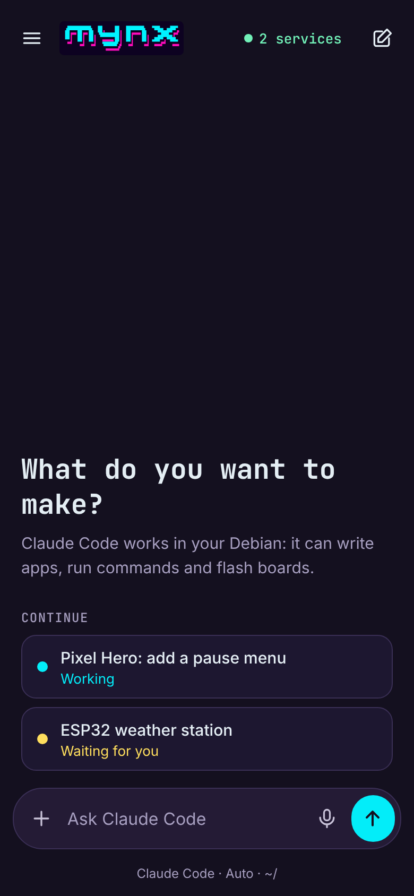
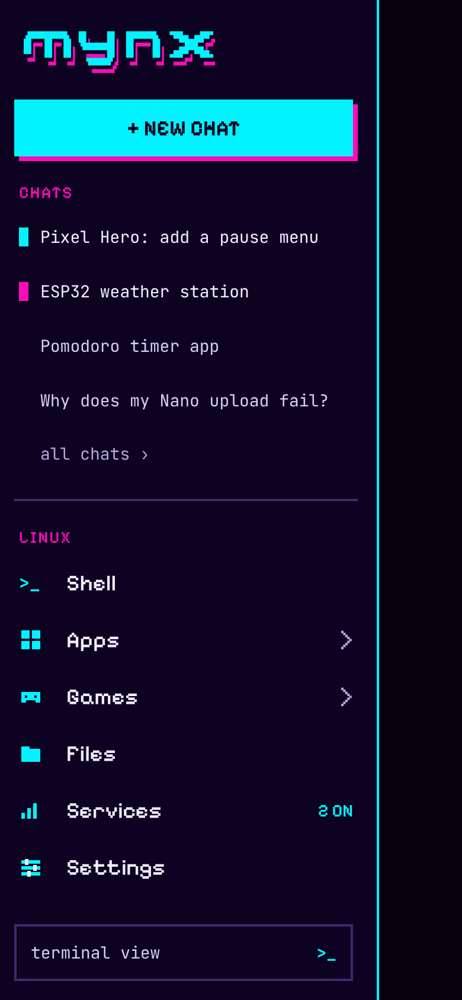

# Touch mode: chat first, with a drawer

The design for touch view's next step (maintainer's decision,
2026-11-11). The alternative was a launcher button next to the prompt
box, opening a sheet of Home's items from the bottom; if it's chosen
instead, switch before touch mode's first release, while nobody has
learned the drawer. The pictures
are mock-ups from a design study, drawn in a browser at 390 × 844 dp
(2× pixels): sample data, not the app. Where this text and a picture
differ, the text wins.

| Pixel style | First pass |
|---|---|
|  |  |
|  |  |
|  | The chat screen as built today (CI's `screenshots`) |

## Screens

**Chat home** (touch view's start screen, replacing Home's list):
- Top row: ☰ (opens the drawer), the title art, and the services
  count (`● N`, as the strip's `servicesMark()`), which opens the
  Services list. Nothing when no service runs.
- A heading ("What do you want to make?") and one line on what the
  agent can do, pushed to the bottom half so the thumb reaches it.
- **Continue:** live chats only, `ChatHub`'s rows with a
  `ChatRowState` of `WORKING` (cyan mark, "working") or `WAITING`
  (pink mark, "waiting for you"); idle and past chats stay in the
  history. At most three; none, no heading.
- The prompt box as the chat screen's (+ for context, the mic,
  Send); the mock-ups leave the mic out, keep it. Sending starts a
  new chat (`ChatHub.newChat()`) and shows it.
- A line under it: agent, mode and folder ("claude code · auto · ~/").
- Claude Code not installed: the box is replaced by an Install
  button (`menu --act agent:claude`), as Home's "(install)" item.

**Drawer** (over the chat home, about 82% of the width, a dimmed
scrim over the rest; tap ☰ to open, tap the scrim or Back to close;
no edge swipe, which is Android's Back):
- The title art, then **New chat** (the main action).
- **Pinned:** every pinned chat, under a heading of its own (none
  pinned, no heading); then **Recents:** the latest few others from
  `chatHistory()` (live ones first, marked as on the chat home), then
  **All chats**, which opens the history screen (`ChatHistoryView`),
  grouped the same way: Pinned, then Recents.
- **A chat's long press** (here and in the history; maintainer's
  request, 2026-11-24): the app's own menu (`pixelMenu`, as the ⋮
  menus), dropped from the row: **Pin** (or Unpin), **Rename**,
  **Delete** (after a confirmation). Pinned rows have a pin at their
  end. Rename and Delete ask in `pixelDialog`s: the menu's box (card,
  cyan border, pink shadow), the title in Pixelify, Cancel outlined
  and the main button filled (cyan; Delete pink).
- **Linux:** Home's main list, `HomeMenus.items(HOME_MAIN)`, in
  `menu.conf`'s order and with its actions: Shell, AI agents,
  Services (with the count), Apps, Games, Files,
  Settings by default. The mock-ups show a subset; show them all.
  Items that open a list (`HomeAction.Menu`: Apps, Games, …) get a
  › and open Home's list screen at that list (`HomeView.showMenu()`),
  whose Back returns to the chat home; the others act as on Home.
- At the bottom: **Terminal**, which shows the tabs, as Home's
  Terminal button does today (the `view` setting stays `touch`).

**A chat:** the screen as built (← back, title, mode, the usage ring,
⋮; the + sheet; artifact cards). ← goes to the chat home, not to
Home's list. Only the style changes, if the pixel style is chosen.

**Back** (`MainActivity.goBack()`): a chat → the chat home; the
drawer → closed; history → the chat home; a Home list or the
terminal → the chat home; the chat home → leaves the app, as Home's
main list does today.

## Where the logic goes

- `core`: what the chat home and the drawer list. A small model
  (e.g. `ChatHomeModel`) built from `HomeMenus` and `chatHistory()`:
  the Continue rows, the drawer's chats (how many, which first), the
  Linux items. Test-first; reuse `tests/fixtures/menu.conf`.
- `app`: `ChatHomeView` and `DrawerView`, thin, drawing that model;
  `MainActivity` shows the chat home where it showed `HomeView` in
  touch view. The service keeps which screen shows (`chatPlace`), so
  a recreated activity comes back to it.
- Screenshots: add the chat home and the drawer to
  `app/src/test/.../Screenshots.kt` at the usual sizes (412 and 360
  dp wide, landscape).

## Style (not decided: ask the maintainer)

Both versions use the same layout. The pixel style matched the logo
better in the study; the first pass is closer to today's screens.

**Pixel style**, taken from `docs/images/mynx.svg`:
- Colours (Neon's; another terminal theme gives its own, worked
  out by `pixelPalette()`: maintainer, 2026-11-11): background
  `#0D0221`; cards and fields `#170838`; lines
  `#3D2A70`; text `#F2ECFF`, secondary text `#B3A6DC`; cyan `#00F3FF`
  (actions, "working", focus); pink `#FF0BBB` (the shadow, section
  labels, "waiting for you"; `#FF7FDC` for pink text on dark).
- Shapes: square corners; 2 dp borders; the logo's hard drop shadow,
  4 dp right and down in pink, only on the main action of a screen
  (the prompt box, New chat, an artifact card).
- Icons drawn from blocks on a 20-unit grid, filled, no curves.
- Type: the mock-ups use Pixelify Sans (labels, buttons, headings)
  and JetBrains Mono (text). The app bundles only JetBrains Mono
  Nerd Font Mono; JetBrains Mono everywhere was the agent's
  suggestion. A second font would need fetching like the first
  (`scripts/fetch-font.sh`) and crediting in `mynx about`.

**First pass:** the theme's colours (Neon's `colors.properties`),
rounded cards (14-28 dp), Inter for text and JetBrains Mono for the
heading; Inter isn't bundled either.

Either way: the logo is `mynx.svg` as it is (never redrawn or
recoloured); touch targets at least 44 dp; text at least 4.5:1
against its background.

## Files (touch mode's file manager)

The maintainer's decisions (2026-11-21): touch mode's **Files**
opens this screen in place of nnn (nnn stays, as "Files (nnn)" in
Apps → Terminal apps and in the terminal's menu); Delete is permanent, after
a confirmation; it starts at `~`, with the phone's storage among the
places.

**The screen** (`FilesView`, over the terminal as Home is):
- Top row: ← (Back), the folder's path as crumbs (`~ / src / app`,
  each one taps to that folder), ⋮ (Show hidden files, New folder).
- Places, a row of chips under it: Home, Download, Phone, Debian
  (`FILE_PLACES`).
- The list: folders first, then files, by name ignoring case; each
  row an icon (folder, file, link) or a picture's thumbnail (a 40 dp
  square, decoded once its row scrolls into sight), the name, and
  size · date. Hidden (dot) names only when shown. An empty folder says so;
  one that can't be read says why.
- Tap a folder: opens it. Tap a picture: `ImageViewActivity`. Tap
  another file: Android's "open with" (`ACTION_VIEW` through
  `ShareProvider`), else Share.
- Long-press selects; then taps toggle, and the top row becomes
  "N selected" with Copy, Cut, Rename (one only), Delete, Share, ✕.
- Rename, New folder and Delete ask in `pixelDialog`s, as a chat
  row's do (title "Rename", "New folder", "Delete?"): Rename selects
  the name before its extension; a name that won't do greys the main
  button, with why in a pink line under the field.
- Copy/Cut keep a clip (paths and the op) across folders; a bar at
  the bottom says "N to paste" with **Paste here** and ✕.
- Bottom actions, always: **Chat here** (a new chat whose agent runs
  in this folder: `ChatHub.newChat(cwd)`), **Terminal here** (a new
  tab with a shell in it: `TerminalService.newSession(cwd = …)`).
- Back: leaves the selection, else goes up a folder, else (at one
  of the places, `filesBack()`) to the chat home, so it never climbs
  into `/storage/emulated`, which Android won't list.

**Every change runs in Debian**, never through `java.io.File`: proot
fakes hard links (`--link2symlink`, `.l2s.*` files with host paths),
so a rename or delete from the app's side breaks them, and
`deleteRecursively()` follows links. The app runs each job's `argv`
in a proot of its own (`TerminalService.runInDebian`) and shows its
output on screen if it fails. Listing reads through `WebApps`
(`host()`, `resolve()`), read-only.

**core** (`FileBrowser.kt`, tested):
```kotlin
data class FileEntry(val name: String, val path: String, val folder: Boolean,
                     val link: Boolean, val size: Long, val modified: Long)
fun listFolder(apps: WebApps, folder: String, showHidden: Boolean): Result<List<FileEntry>>
fun folderCrumbs(path: String, home: String): List<Pair<String, String>>  // label to path
fun parentFolder(path: String): String?                                   // null at "/"
val FILE_PLACES: List<Pair<String, String>>                               // label to path
fun fileSizeText(bytes: Long): String                                     // "0 B", "12 KB", "3.4 MB"
fun isPictureName(name: String): Boolean                                  // as chatImageFile()
fun fileNameProblem(name: String): String?                                // null when fine
fun pasteName(name: String, taken: Set<String>): String                   // "a (2).txt"
enum class ClipOp { COPY, MOVE }
data class FileClip(val op: ClipOp, val paths: List<String>)
sealed interface FileJob {
    data class Run(val argv: List<String>, val title: String) : FileJob
    data class Refused(val reason: String) : FileJob
}
fun pasteJob(clip: FileClip, dest: String, taken: Set<String>): FileJob
fun deleteJob(paths: List<String>): FileJob
fun renameJob(path: String, newName: String, taken: Set<String>): FileJob
fun newFolderJob(parent: String, name: String, taken: Set<String>): FileJob
```
`HomeAction.Files(folder)` is the Files item's action (the main
list's `files`). `ChatHub.newChat(cwd: String = this.cwd)`.

**app:** `FilesView` (thin, drawing core's results), `MainActivity`
showing it (`filesShown`, `goBack()`), `TerminalService.runInDebian(argv,
done)` and `newSession(command, cwd)`; a `files` screenshot.

The phone's storage: until Android allows all of it, Files in
`/storage` shows a bar ("Android shows mynx only some of the phone's
files." **Allow**), which opens Android's All files access page (a
dialog before Android 11); back from it, Files lists the folder again
and the bar goes. A chat started here is listed in the history with
its folder, live or past, and resumes there.

## Viewers: text, code, Markdown, audio and video

The maintainer's decisions (2026-11-21): mynx gets its own viewers
for text (a notepad), source code, Markdown, audio and video, and
opens supported files in them **by default**, from Files, from chat
and from the terminal. A setting per kind picks mynx's viewer or
another Android app. Text, code and Markdown open **to view, with an
Edit button**. In the terminal, `mynx open FILE` **asks** which to
open with, unless the command says (`--with`); without a terminal (an
agent, a script) it uses the setting, so nothing waits on a prompt.

### Kinds and settings

| Kind | Files | Setting | mynx's viewer |
|---|---|---|---|
| picture | `chatImageFile()`'s | `open-pictures` | `ImageViewActivity` (exists) |
| markdown | `.md`, `.markdown` | `open-markdown` | `TextViewActivity`, drawn as in chat |
| code | a language `codeLanguageOf()` knows | `open-code` | `TextViewActivity`, highlighted |
| text | `.txt`, `.log`, `.csv`, …, or any file that looks like text | `open-text` | `TextViewActivity`, plain |
| audio | mp3, m4a, aac, ogg, opus, flac, wav, mid | `open-audio` | `MediaViewActivity` |
| video | mp4, webm, mkv, 3gp, mov | `open-video` | `MediaViewActivity` |

Each setting is `mynx` (the default) or `android` (Android's "open
with"). They're in `settings.conf`, `mynx set open-code android`, and
a new **Default apps** group in Settings (`HomeSettings`). Anything
else (no kind, a binary file) opens with Android, else Share, as today.

### Opening

- **Files:** a tap opens the file as its setting says. Selecting one
  file adds **Open with…** (mynx's viewer, or another app).
- **Chat:** an attachment chip of any kind opens in its viewer, as
  pictures' do. Cards: a Markdown card's first action is **View**
  (then Copy, Share); audio and video written or named in a turn get
  cards like pictures' (**Play**, Share); code and text files written
  or edited in a turn (and not already some card) get one
  **Changed files** card per turn: each file a row (name, folder)
  that opens it in the code viewer. A file counts as written by Write
  or Edit, or by a command's `>`, `>>` or `tee` (Claude often writes
  with `cat > FILE <<'EOF'`) when it changed in the turn. When the turn
  ends, its cards move below its last words (maintainer's test,
  2026-11-21: they sat above them, out of sight).
- **Paths in replies:** code in Claude's text that names a file that's
  there (`~/scripts/run.sh`, `README.md`, `a.py:12`) is underlined, a
  link that opens the file as its setting says (maintainer's decision,
  2026-11-21: underlined, so it's clear it's a link).
- **Terminal:** `mynx open URL | FILE [--with mynx|android] [--edit]`.
  A relative FILE is against the current folder. In a terminal, with
  no `--with`, it asks:
  ```
  Open notes.md with:
    1) mynx's Markdown viewer (default)
    2) another Android app
  Choose [1]:
  ```
  Enter takes the setting's choice. `--edit` opens text, code and
  Markdown ready to edit. The app must be on screen (as for links).
  `xdg-open` takes files too (`mynx open`, so it asks as well).
  `--json`: `{"ok": true, "with": "mynx", "kind": "code"}`.

### The text viewer (`TextViewActivity`: text, code, Markdown)

- Top bar: ←, the file name (the folder under it, dim), **Edit**, ⋮
  (Wrap lines, Find, Replace, Share, Open with…, Copy path). Markdown adds a
  **View / Edit** switch in place of Edit.
- **View:** read-only, selectable. Code and text in the terminal's
  font with line numbers, horizontally scrolled unless Wrap is on
  (on by default for text and Markdown, off for code). Code is
  highlighted in the terminal theme's colours. Markdown is drawn as
  chat draws it, plus pictures (relative to the file) and links to
  other local files (they open in their viewer).
- **Edit:** an `EditText` with the same font and highlighting
  (re-run off the main thread after typing stops, ~300 ms); the top
  bar gets **Save** and Undo/Redo. Back with unsaved changes asks:
  Save, Discard, Cancel.
- **Saving runs in Debian** (as Files' jobs): the text is written to
  a temporary file in `/tmp/.mynx/saves/`, then `sh -c 'cat "$1" >
  "$2" && rm -f "$1"'`, so the file is changed in place (its links,
  owner and mode kept). If the file changed on disk since it was
  read, Save asks: Overwrite, Reload, Cancel.
- Limits: files over 1 MB open read-only and show their first 1 MB
  (a line says so). Text that isn't UTF-8 (or has NUL bytes) isn't
  text: "Open with another app". Line endings (LF, CRLF) and a final
  newline are kept as they were.
- **Find** (⋮ or Ctrl+F): a bar with the matches' count, ↑ ↓, case
  ignored.
- **Replace** (⋮, Ctrl+H, or ⇄ in the Find bar; not for read-only
  files): a second row under Find, "Replace with", **Replace** (the
  current match, then on to the next; Enter does it too) and **All**
  ("Replaced 5"). It switches to Edit first, since it changes the
  text: Save writes it, and each Replace or All is one Undo step.
  Leaving Edit hides the row.
- Keyboard: Ctrl+S saves, Ctrl+F finds, Ctrl+H replaces, Esc leaves Edit (asks if
  changed), as the keyboard-first rule wants.

### The media player (`MediaViewActivity`: audio and video)

- **Video:** black, full screen, Android's `MediaPlayer` (no new
  dependency); the picture fits and turns with the phone. A tap shows
  the controls (←, name, play/pause, a seek bar with times, ⟲10 /
  10⟳); they hide after 3 s of play. Double-tap left/right seeks 10 s.
- **Audio:** the name, the folder, a big play/pause, the seek bar,
  previous/next through the folder's other audio files (by name),
  and speed (1×, 1.25×, 1.5×, 2×, 0.75×).
- **Audio keeps playing** when the screen goes off or the app leaves
  (a foreground service, `MediaPlaybackService`, with a media
  notification: play/pause, next, close, and the lock screen's
  controls through a `MediaSession`); video pauses.
- A file Android can't play says so on screen, with Open with
  another app.

### Code: where it goes

**core** (tested; one file per bullet):
- `FileKinds.kt`:
  ```kotlin
  enum class FileKind { PICTURE, MARKDOWN, CODE, TEXT, AUDIO, VIDEO }
  fun fileKindOf(name: String): FileKind?        // by name only
  fun looksLikeText(head: ByteArray): Boolean    // UTF-8, no NUL (first 8 KB)
  fun codeLanguageOf(name: String): String?      // "python", "kotlin", "shell", …
  enum class OpenWith { MYNX, ANDROID }
  fun Settings.openWith(kind: FileKind): OpenWith
  ```
  `Settings` gets `openPictures`, `openMarkdown`, `openCode`,
  `openText`, `openAudio`, `openVideo` (`SETTINGS`, `HomeSettings`'
  "Default apps" group).
- `MynxRequests.kt`: `open-file PATH WITH EDIT` (WITH: `mynx`,
  `android` or `default`; EDIT `0`/`1`): checks the file, works out
  the kind, answers `{"with": …, "kind": …}`, and calls a new
  constructor callback `openFile(path: String, kind: FileKind?, with:
  OpenWith, edit: Boolean): String?` (null when it opened, else why
  not). `mynx open`'s question is asked by `cli.py` (it sends
  `open-file-kind PATH` first for the kind and the setting's choice).
- `TextDoc.kt`: the editor's model. `loadText(bytes, size):
  TextLoad` (the text, line ending, final newline, truncated,
  read-only and why); `TextDoc` (text, saved text, dirty, the file's
  time when read); `saveText(doc, text): ByteArray` (line endings
  back as found); `saveJob(temp, path): FileJob`;
  `findMatches(text, query): List<IntRange>`; `replaceMatch()` and
  `replaceAll()` (the new text, the edit, the next match);
  `lineStarts(text)` for
  the numbers.
- `Syntax.kt`: `highlight(text: String, language: String):
  List<SyntaxSpan>` (`start`, `end`, `kind`: KEYWORD, TYPE, STRING,
  COMMENT, NUMBER, CONSTANT, FUNCTION, TAG, ATTRIBUTE, OPERATOR,
  HEADING, ADDED, REMOVED), from a table of languages (keywords,
  comments, strings, number forms) plus lexers for HTML/XML, Markdown
  and diff. Languages at first: Python, shell, Kotlin, Java,
  JavaScript/TypeScript, C/C++, Rust, Go, Lua, Ruby, PHP, SQL, JSON,
  YAML, TOML/INI/conf, HTML/XML, CSS, Dockerfile, Makefile, diff.
  `syntaxColor(kind, scheme: ColorScheme): Int` from the theme's
  palette (keywords magenta, strings green, comments dim, …), each
  readable on the background (`contrast()` ≥ 3). Fast enough for 1 MB
  in well under a second on the phone; a span never crosses the text's
  end; unknown text is never dropped.
- `Media.kt`: `mediaTime(ms): String` ("0:07", "1:02:03"),
  `mediaQueue(names: List<String>, current: String): List<String>`
  (the folder's audio files by name, ignoring case), `nextSpeed()`,
  `seekBy(position, delta, duration)`.
- `ChatArtifacts.kt`: `ArtifactKind.AUDIO`, `VIDEO`, `CHANGED_FILES`
  (`ChatArtifact.files: List<String>`); the actions View (Markdown),
  Play (audio, video); the rules as above, tested like pictures'.

**app** (thin):
- `TextViewActivity` (+ `MarkdownViews`, the Markdown drawing moved
  out of `ChatView` so both use it; chat's code blocks get highlighted
  too), `MediaViewActivity`, `MediaPlaybackService` (manifest:
  `FOREGROUND_SERVICE_MEDIA_PLAYBACK`).
- `TerminalService.openFile(…)` for the request, and an
  `openDebianFile(path, with)` that Files and chat use too;
  `saveDebianText(path, bytes, done)` through `runInDebian`.
- `FilesView`'s Open with…, `ChatView`'s chips and cards,
  `MainActivity` wiring, the Settings group.
- Screenshots: the text viewer (code, Markdown, Edit with the
  keyboard), the audio player, the cards.

**tools/**: `cli.py` (`mynx open FILE`, the question, `--with`,
`--edit`), `xdg-open`, the guide (`tools/AGENTS.md`'s `mynx open`
line and a "Files and viewers" part of `tools/docs/phone.md`),
tests in `tests/mynx/` and `tests/shell/`.

### Building it: agents in waves

Each agent works in a git worktree of its own on a branch off
`viewers`, test-first, and only in the files its row names; it
commits there and reports. Between waves the lead merges the
branches into `viewers` and runs every local suite; after wave 2
and wave 3, CI builds the app (it only compiles there), and the
lead fixes what the compiler finds. One PR, `viewers` into `main`;
the maintainer tests the build in mynx dev before the merge.

| Wave | Agent | Owns |
|---|---|---|
| 1 | **core-open** | `FileKinds.kt`, `Settings.kt`, `HomeSettings.kt`, `MynxRequests.kt` (open-file), `Media.kt`; `cli.py`, `xdg-open`, the guide, their tests |
| 1 | **core-text** | `TextDoc.kt`, `Syntax.kt`, `ChatArtifacts.kt` (new kinds), their tests |
| 2 | **app-text** | `TextViewActivity`, `MarkdownViews` (moved out of `ChatView`: only that part of it), the manifest entry, text screenshots |
| 2 | **app-media** | `MediaViewActivity`, `MediaPlaybackService`, manifest entries, media screenshots |
| 3 | **app-wiring** | `TerminalService`, `MainActivity`, `FilesView`, `ChatView`'s chips and cards, the Settings group, cards screenshots |

Docs before the merge: `docs/ARCHITECTURE.md` (a "viewers" entry),
the README, the roadmap, the work log.

### Later (suggested, not decided)

- A **diff view** in chat: a changed file's rows open what changed
  in the turn, drawn with `Syntax.kt`'s `diff`.
- A **PDF viewer** (Android's `PdfRenderer`, no dependency) and
  **HTML files** in the web apps' WebView.
- Opening files **from other apps** (Android's Files → mynx's
  viewer), saving back through the content URI.

## More viewers: a turn's changes, PDF and HTML

The maintainer's request (2026-11-21), after the viewers: the diff
view in chat, a PDF viewer and HTML files, from the viewers' "later"
list. The choices below are the lead's, for the maintainer to change
on the phone test.

### A turn's changes (the diff view)

- **Where from:** Claude Code's transcript has, for every Write and
  Edit, a `toolUseResult` with `originalFile` (the file before that
  call; null for a new file), `structuredPatch` (hunks:
  `oldStart`, `oldLines`, `newStart`, `newLines`, `lines` with ` `,
  `-`, `+`, `\`) and, for a Write, `content`. The transcript is on disk
  while the chat runs (`claudeTranscriptPath()`), so the app reads it
  when it needs a diff, off the main thread; a live chat needs nothing
  more from the stream.
- **One diff per file per turn:** before = the first call's
  `originalFile` in the turn (empty when the file is new); after = the
  last call's result (a Write's `content`, an Edit's `originalFile`
  with its patch applied). core diffs the two (lines, Myers, 3 lines
  of context), so several edits read as one change, and a later turn's
  edits never show in this one. A file a command wrote (`cat >`) has
  no patch: its row opens the file, as today.
- **The Changed files card:** each row shows `+N −M` (or "new") once
  worked out, and a tap opens the **diff view** (a file with no diff:
  the viewer, as now).
- **The diff view** (`DiffViewActivity`): top bar ←, the file name
  and folder, `+N −M`, ⋮ (Open file: the viewer; Share the diff as a
  `.diff`; Wrap lines). The body: hunks one after another, each under
  an `@@ … @@` line; each line with its old and new line numbers, a
  `+`/`−` mark, added lines on a green tint and removed ones on red
  (the theme's palette, readable), the text highlighted for the file's
  language; unchanged lines between hunks fold into "⋯ N lines". A
  new file shows all its lines as added. Over 1 MB on either side:
  "too big to diff here", with Open file.

### PDF

- **Kind** `PDF` (`.pdf`), setting `open-pdf` (`mynx` | `android`,
  default `mynx`), in Default apps.
- **`PdfViewActivity`:** Android's `PdfRenderer` (no dependency). The
  pages one under another on a grey background, each as wide as the
  screen, rendered when near sight (and dropped when far, to bound
  memory), sharper once a zoom settles; pinch and double-tap zoom
  (core's `ImageZoom` or the like), a page indicator ("3 / 12") that
  fades, ⋮: Go to page, Share, Open with another app. A
  password-protected or broken PDF says so on screen, with Open with
  another app.
- **Selecting text (Android 15+):** API 35 gave `PdfRenderer.Page`
  text (`selectContent()`, `getTextContents()`), so on Android 15
  and later a long press on a page selects the word under it (a drag
  on extends it); the selection is tinted in the accent, with a handle
  at each end to drag it further within that page (not across pages).
  A bar above it (below it without room there, else at the top):
  Copy (the clipboard, "Copied"), Select all (the page's
  text), ✕. A tap elsewhere, Back or Esc clears it; Ctrl+C copies.
  Zoom and scroll keep working, the selection following. Older
  Androids show the pages only.
- **Find (Android 15+):** ⋮ Find or Ctrl+F: a bar at the bottom
  (as the text viewer's) with the count, ↑ ↓ and ✕. It searches
  `searchText()` a page at a time on the renderer's worker, so pages
  keep rendering and the count grows ("2/7…" until every page is
  done); typing searches again once it stops for 300 ms, Enter goes to
  the next match. The current match is the first at or after the page
  in view (else the first): pink, the others tinted in the accent;
  ↑ ↓ scroll it into sight (a third down, centred across when zoomed).
  Back or Esc closes it. Older Androids have no Find.
- **Chat:** a PDF Claude writes or makes (named in a command and
  changed in the turn, as pictures) gets a card with View and Share;
  chips open in the viewer.

### HTML files

- **Kind** `HTML` (`.html`, `.htm`), setting `open-html`, in Default
  apps. HTML stops being "code": it opens **rendered**, and the
  viewer's ⋮ has **View source** (the code viewer).
- **`HtmlViewActivity`:** a WebView showing the file, its folder
  served read-only through `shouldInterceptRequest` on a host of its
  own (as web apps are, from core), so relative CSS, scripts and
  pictures work; JavaScript on; the web reachable (CDN scripts); no
  `mynx.js` bridge (a file isn't an app: no phone access). Links to
  other files in the folder open in the WebView, web links in the
  browser. Top bar: ←, the page's title (else the file name), ⋮
  (Reload, View source, Share, Open with another app). Pages in
  `~/apps` stay web apps there; this is for any other HTML file.
- **Chat:** an HTML file outside the app folders that Claude writes
  gets a card: **View** (rendered), View source, Share.

### Code: where it goes, and the waves

| Wave | Agent | Owns |
|---|---|---|
| 1 | **core-diff** | `Diff.kt` (line diff, hunks with context, counts, applying a `structuredPatch`, the turn's before/after from its edits), reading `toolUseResult`s by tool call ID from a transcript (`ClaudeHistory.kt`), `ChangedFileRow`'s tool call IDs (`ChatArtifacts.kt`: only that) |
| 1 | **core-kinds** | `FileKind.PDF`/`HTML`, `open-pdf`/`open-html` (`Settings.kt`, `HomeSettings.kt`), `Viewer.PDF`/`WEB` (`Viewers.kt`), the PDF and HTML cards (`ChatArtifacts.kt`: those only), `mynx open`'s names (`cli.py`), the guide; serving a file's folder for the HTML viewer (`WebApps.kt`) |
| 2 | **app-diff** | `DiffViewActivity`, the Changed files card's rows (`ChatView.kt`: that part), its screenshots |
| 2 | **app-pdf** | `PdfViewActivity`, its screenshots |
| 2 | **app-html** | `HtmlViewActivity`, its screenshots |
| 3 | lead | the opener (`TerminalService.openDebianFileWith()`), Files' icons, chat's PDF and HTML cards, the manifest, the docs |
